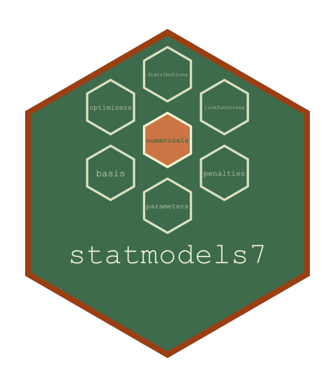

<!-- README.md is generated from README.Rmd. Please edit that file, then
     regenerate with devtools::build_readme(). Do not use knitr::knit(): it
     processes the code but leaves this YAML header in the output as literal
     text, which GitHub and pkgdown both render verbatim. -->

<!-- badges: start -->
[](https://github.com/statmodels7/statmodels7/actions/workflows/R-CMD-check.yaml)
[](https://app.codecov.io/gh/statmodels7/statmodels7)
[](https://lifecycle.r-lib.org/articles/stages.html#experimental)
<!-- badges: end -->

```{r, include = FALSE}
knitr::opts_chunk$set(
  collapse = TRUE,
  comment = "#>"
)
```

# statmodels7 

`{statmodels7}` is the modeling layer of the
[statmodels7](https://statmodels7.github.io) toolkit, and the package that
installs the rest of it. `statmod()` reads one formula carrying an equation
for every parameter of a distribution and fits it, with any term of
[modelterms7](https://statmodels7.github.io/modelterms7/) in any of those
equations.

## Installation

```r
# install.packages("pak")
pak::pak("statmodels7/statmodels7")
```

Attaching it attaches the eight member packages.

```{r}
library(statmodels7)
```

## Fitting a model

The equations are separated by a bar, one for each parameter of the
distribution, and a parameter with no equation of its own is given an
intercept. Below, the mean carries a penalized smooth of `x` and a random
intercept over `g`, and the standard deviation is linear in `x` on its log
scale.

```{r}
set.seed(1)
n <- 400
d <- data.frame(x = runif(n, min = -2, max = 2),
                g = factor(rep(1:20, length.out = n)))
u <- rnorm(20, mean = 0, sd = 0.5)
d$y <- sin(2 * d$x) + u[as.integer(d$g)] + rnorm(n, sd = exp(-0.7 + 0.4 * d$x))

fit <- statmod(y ~ s(x) + random(~ 1 | g) | sigma ~ x,
               distrib = gaussian1_distrib(), data = d)
```

The smoothing parameter of the smooth and the scale of the random effect are
hyperparameters. They are estimated by REML, whose gradient and Hessian are
computed exactly, and `hyper()` reports each value with its source: the
criterion that estimated it, or `fixed` for a value held in the term.

```{r}
hyper(fit)
```

`summary()` prints the coefficients and the hyperparameters of each equation,
with the effective degrees of freedom of each penalized term.

```{r}
summary(fit)
```

After the conditional log-likelihood and the information criteria, the table
ends with two lines headed `inner` and `outer`. Each gives the largest
gradient in standard errors and the smallest eigenvalue of the curvature, for
the coefficients and for the hyperparameters respectively, both read at the
point the fit reached.

`statmod_certificate()` is computed at the same point and not read off the
stopping rule of the optimizer. Its `mode_error` is how far above its own
penalized mode the coefficients stopped, in log-likelihood units, and its
`state` is `converged`, `boundary`, `not converged` or `unknown`.

```{r}
statmod_certificate(fit)[c("state", "mode_error")]
```

`predict()` returns the fitted value of any parameter, or of a moment of the
response, with a standard error that follows from every term in the model.

```{r}
predict(fit, what = "mu", newdata = head(d, n = 3), se = TRUE)
```

## What the layer fits

Any term of `modelterms7` goes in any equation: the parametric block,
penalized smooths of one and several covariates, grouped random intercepts
and slopes, ridge, lasso, elastic net, SCAD and MCP, a nonlinear parametric
term, effects that change at estimated break-points, score-driven dynamics
and latent Markov regimes. A formula carries at most one score-driven term,
regime term or break-point term built with `marginal = TRUE`. A score-driven
term is fitted in one system with the coefficients, and `vcov()` is built from
the observed information of that joint model. A regime term, or a marginal
break-point term, is fitted by alternating with the coefficients.

The hyperparameters of a smooth penalty are estimated by `reml()` or `ml()`,
or by `aic()` or `bic()` on an estimate of prediction error, all passed as
`outer_criterion`. A penalty with a kink (`lasso()`, `enet()`, `scad()` and
`mcp()`) has no second derivative at the mode, so its hyperparameter is
chosen along a path of its own values, from the value that empties the block
downwards. The path is scored by `sparse_criterion`, which is `bic()` by
default and may also be `aic()` or `cv()`. The function `cv()` serves only as
`sparse_criterion`.

Random effects written with the same label and the same grouping share one
covariance block, whatever equation they sit in, as with the middle bar of
`(1 | u | id)` in `brms`. The formula
`y ~ random(~ 1 | u | id) | sigma ~ random(~ 1 | u | id)` estimates the
correlation between a subject's level and the logarithm of its scale. The
label reaches a subformula too, so `seg(x, psi ~ random(~ 1 | u | id))` in the
same formula correlates a random break-point with a random scale. The block is
one multivariate prior over the effects of one level, parametrized by
`dr_prod()` by default, whose free coordinates are the logarithms of the
standard deviations followed by the angles of the correlation.

`rstatmod()` simulates from a model written the same way and returns the
parameters used beside the data.

```{r}
sim <- rstatmod(y ~ x, distrib = gaussian1_distrib(), data = d[1:20, ],
                par = list(mu = c(1, 2), sigma = log(0.3)))
sim$par
```

The vignette
[fitting a distributional model](https://statmodels7.github.io/statmodels7/articles/fitting-a-distributional-model.html)
works through a fit from the formula to the fitted object.

## The toolkit in one package

Installing this package installs the eight members, and attaching it attaches
them. The members are listed in `Imports` and attached by the package itself,
which prints one message with the version of each; `Depends` would attach
them without a report.

```{r}
statmodels7_packages()
```

| package | what it provides |
|---|---|
| [numericals7](https://statmodels7.github.io/numericals7/) | the numerical layer at the root: stencils, batched quadrature and series, the combinatorial enumerations, special functions |
| [linkfunctions7](https://statmodels7.github.io/linkfunctions7/) | link functions as objects, with exact derivatives to fifth order in both directions |
| [distributions7](https://statmodels7.github.io/distributions7/) | univariate and multivariate distributions with exact score, information and higher derivatives |
| [optimizers7](https://statmodels7.github.io/optimizers7/) | optimization algorithms as objects, with composable stopping rules |
| [basis7](https://statmodels7.github.io/basis7/) | basis expansions with derivatives, anchored integrals and exact Gram matrices |
| [parameters7](https://statmodels7.github.io/parameters7/) | constrained parameters as maps from an unconstrained vector, exact to fourth order |
| [penalties7](https://statmodels7.github.io/penalties7/) | penalties as objects, with exact derivatives, proximal operators and the pieces a marginal criterion consumes |
| [modelterms7](https://statmodels7.github.io/modelterms7/) | model terms as objects, each carrying its design block, its penalty and its blueprint for new data |

`statmodels7_versions()` reports the installed version of each member,
`statmodels7_conflicts()` the names that members mask from one another, and
`statmodels7_update(action = "install")` installs or updates every member.

## Related

The mathematical companion to the toolkit is the
[book](https://statmodels7.github.io/book/), which presents the formulas that
the packages implement, explains where each quantity comes from and cites the
source of the full argument.
